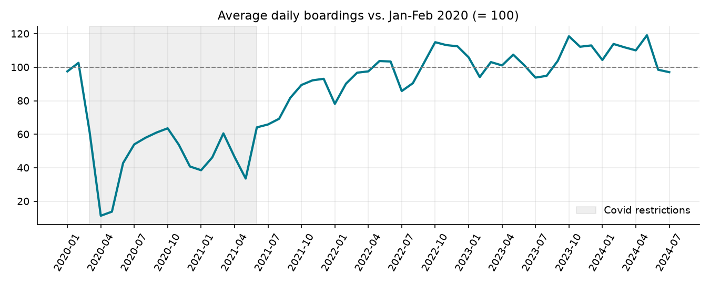
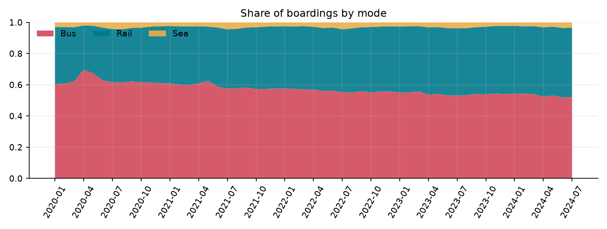
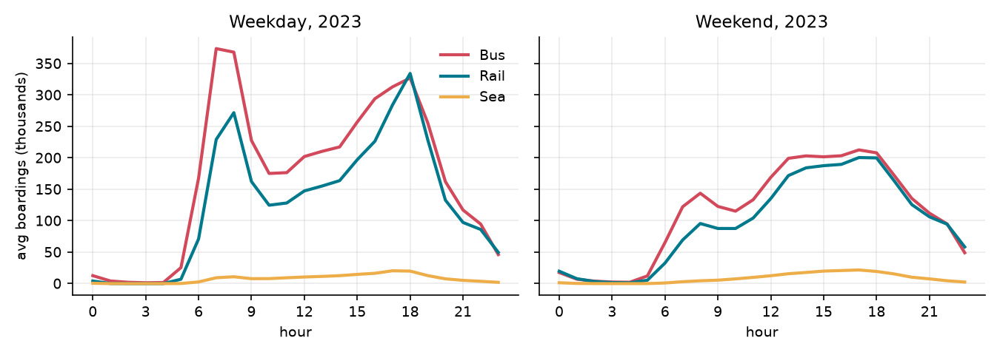
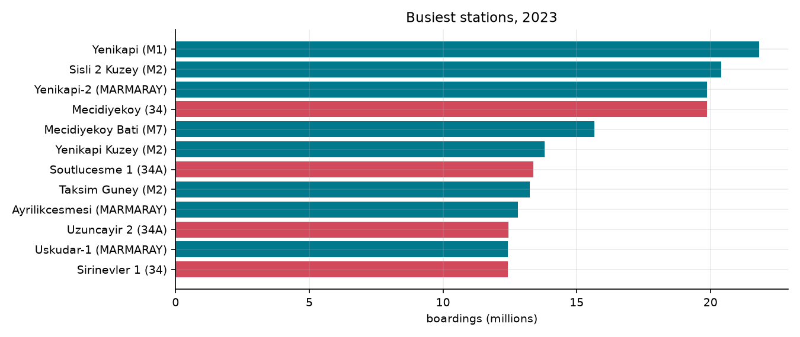
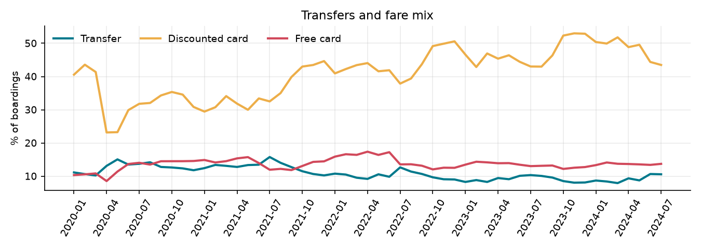

# Istanbul Public Transport Analytics

How do 7 million daily trips move through Istanbul, how did ridership survive the pandemic, and when
and where does the network peak? This project turns **700 million rows** of Istanbul Metropolitan
Municipality open data (hourly card boardings, Jan 2020 to Oct 2024) into a tested SQL warehouse,
business KPIs and dashboards.

**Stack:** Python · DuckDB (SQL) · star schema · pytest data quality checks · matplotlib · Tableau Public

> **Dashboard:** [Istanbul Public Transport Analytics on Tableau Public](https://public.tableau.com/app/profile/bertan.sezgin/viz/IstanbulPublicTransportAnalytics/IstanbulPublicTransport2020-2024)



## Key findings (2023, the latest full year)

| | |
|---|---|
| Boardings | **2.45 billion**, 6.71 million per day, **+5.1%** vs. 2022 |
| Pandemic low | **11%** of the early-2020 level in April 2020 |
| Back to pre-pandemic level | **May 2022**; from autumn 2023 mostly 5-20% above it |
| Mode mix | Bus 54% (incl. Metrobus), Rail 43%, Sea 3% |
| Weekday peak | **18:00**; the morning peak is sharper on buses (07:00-08:00) |
| Weekend volume | 72% of a weekday |
| Busiest line | **34 Metrobus** (Avcilar-Zincirlikuyu), 235 million boardings |
| Busiest station | **Yenikapi (M1)**, 21.8 million boardings |
| Fare mix | 47% discounted cards, 13% free cards, 9% transfers |
| Holidays | Feast of Sacrifice days run **16%** below comparable days |

**The discounted-card share follows the school calendar:** it drops to ~40% in July and jumps to
~51% from October, when students are back. Capacity and pricing plans for the network should be
read against this seasonal mix, not only total volume.

More numbers: [`docs/findings.md`](docs/findings.md). Data issues: [`docs/data_quality.md`](docs/data_quality.md).

| | |
|---|---|
|  |  |
|  |  |

## Pipeline

```
IBB open data portal (58 monthly CSVs, ~65 GB)
        │  ingest/ingest.py: download one month (gzip), aggregate with DuckDB, delete raw file
        ▼
data/agg/*.parquet              daily x line x fare · hourly x mode · daily x station
        │  build.py runs models/*.sql
        ▼
data/warehouse.duckdb
   staging  →  dimensions (date, mode, line, fare, month quality)
            →  facts (daily ridership, hourly ridership, station daily)
            →  marts (monthly KPIs, mode share, hourly profile, line/station rankings,
                      districts, holiday effect)
        │  tests/  (pytest data quality checks)
        │  analysis/report.py
        ▼
docs/figures · docs/findings.md · docs/data_quality.md · tableau/data/*.csv  →  Tableau Public
```

## Data model

| Table | Grain |
|---|---|
| `dim_date` | day, with weekend, Turkish public holidays and the Covid restriction period |
| `dim_mode` | Bus / Rail / Sea |
| `dim_line` | line code and route name |
| `dim_fare` | card group (full, discounted, free, staff) and payment type (pay per ride, subscription, transfer) |
| `dim_month_quality` | months with a known source issue |
| `fct_daily_ridership` | day x line x district x fare x transfer |
| `fct_hourly_ridership` | day x hour x mode x district |
| `fct_station_daily` | day x station x line |
| `mart_monthly_kpis` | month: volume, MoM / YoY, recovery index, mode and fare shares, completeness |

The main metric is `passages` (validated boardings, one per card tap).

## Data quality

Ten pytest checks run on every build: no negative counts, passengers never exceed boardings, daily and
hourly totals match exactly, every fact row joins to its dimensions, shares add up to 100%, and
flagged months never count as complete.

Two issues found and handled:

- **Partial publications.** Aug-Oct 2024 files are 4-6x smaller than neighbouring months and show
  17-35% of normal daily volume, while line and district coverage is unchanged. Rows are missing, not
  riders. These months are flagged in `dim_month_quality` and left out of KPIs and charts.
- **Download limits.** The portal cuts connections after about 100 seconds and ignores HTTP range
  requests, so a 1.5 GB month never finished downloading. Requesting gzip transfer encoding shrinks
  each file about 6x and fits in the window; each file is integrity-checked before use.

## Run it

```bash
python -m venv .venv && .venv/bin/pip install -r requirements.txt
.venv/bin/python ingest/ingest.py --start 202001 --end 202410   # about 1 hour, ~1 GB disk at peak
.venv/bin/python build.py
.venv/bin/python -m pytest -q tests
.venv/bin/python analysis/report.py
```

Tableau Public: the [published dashboard](https://public.tableau.com/app/profile/bertan.sezgin/viz/IstanbulPublicTransportAnalytics/IstanbulPublicTransport2020-2024) is built from the four small CSV files in
`tableau/upload/`; the full mart extracts are in `tableau/data/` and the planned layout is in
[`tableau/DASHBOARD.md`](tableau/DASHBOARD.md).

## Source and licence

Istanbul Metropolitan Municipality Open Data Portal, "Hourly Public Transport Data Set"
(https://data.ibb.gov.tr/dataset/hourly-public-transport-data-set), used under the IMM Open Data
Licence. The data covers Istanbulkart boardings on IMM-operated buses, rail and ferries.
